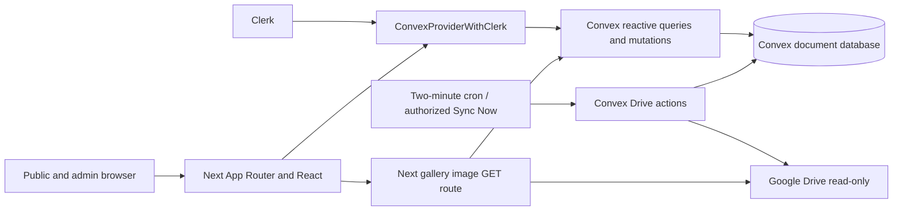

# Savvy Hunt: engineering instructions

Read this file and [memory.md](memory.md) before significant work. This is the requested engineering reference; it supplements, rather than replaces, [AGENTS.md](AGENTS.md) and [CLAUDE.md](CLAUDE.md). The singular filename is not a substitute for tools' automatic `AGENTS.md` discovery.

## 1. Project overview

Savvy Hunt is a school competition website for spectators, participating schools, and authorized organizers. Public pages show schedules, official results, overall/category standings, announcements and approved photographs. Organizers manage schools, events, result revisions, public content and gallery moderation.

Prioritize correct official scores, live updates, permission enforcement, publication consent and usable mobile interfaces. An event being completed does not mean its results are published. Empty states must reflect missing official data; never fabricate scores, winners, counts or photographs.

## 2. Verified stack

- Next.js App Router, TypeScript strict mode and React; npm with committed `package-lock.json`.
- Lockfile baseline: Next 16.4.3, React 19.3.1, Convex 1.48.0, Clerk Next.js 7.9.22, TypeScript 5.9.3, Tailwind 4.3.3, Vitest 5.0.5. Recheck the lockfile after upgrades; manifest ranges differ.
- Convex provides the document database, indexed queries, transactional mutations, actions, scheduled jobs and reactive subscriptions. Clerk authenticates staff; the Convex admin allowlist authorizes them.
- Tailwind 4 via PostCSS plus substantial handwritten shared/feature CSS; custom UI and SVG icons, Fraunces and DM Sans via `next/font/google`; Motion is a dependency.
- Google Drive stores gallery bytes; server-side service-account access is read-only. Convex stores metadata and moderation history. No active website upload workflow.
- Vitest with edge-runtime and convex-test; Playwright/axe-based standalone verification scripts. Vercel is the documented hosting target, not proof of a current production deployment.

## 3. Architecture and source boundaries

| Directory/file | Responsibility |
|---|---|
| `app/` | Public route entries, admin workspace, root providers/layout, error/404 pages and gallery image route |
| `components/` | Navigation, shared UI/data helpers, editorial presentation, home features and admin event forms/dialogs |
| `convex/` | Schema, public/private APIs, authorization, scoring, gallery sync and cron |
| `lib/` | Drive server/validation helpers and school/result/achievement presentation logic |
| `tests/`, `convex/*.test.ts` | Pure logic, SSR/component, server-route and isolated backend tests |
| `scripts/` | Development verification, browser checks and security checks; some mutate external development data |
| `docs/`, root reports | Design history, setup, fixes and release evidence; reconcile older reports with current code |
| `public/` | Static visual assets; do not treat these as official competition data |

`app/layout.tsx` nests Clerk and `app/providers.tsx`; the latter owns one module-scoped ConvexReactClient. `components/data.tsx` resolves the current edition and distinguishes loading from an uninitialized edition. Client `useQuery` subscriptions update the UI after backend commits; do not add polling for standings. Public records are projected by backend queries. Business writes belong in Convex, not a second REST implementation or Server Actions layer. The sole current application API route is `app/api/gallery/[itemId]/image/route.ts`.

## 4. Coding standards

- Before Next.js changes, read the relevant installed guide under `node_modules/next/dist/docs/`; preserve the generated rules in `AGENTS.md`. Before Convex changes, read `convex/_generated/ai/guidelines.md` in full and applicable local Convex skills.
- Keep TypeScript strict. Use generated `Doc`, `Id`, context and API types; narrow unknown errors and input. Prefer generated `api` references for new work. Existing `ref`/`mut`/`act` helpers in `components/data.tsx` are real conventions, but manually typed strings need contract verification.
- Preserve App Router `page.tsx`, `layout.tsx`, error and dynamic route structure. Keep server-only Drive credentials/helpers out of client imports. Use `"use client"` only where hooks/interactions require it. The image route uses Node runtime and asynchronous params.
- Use PascalCase component exports, `use…` hooks, existing kebab-case feature files and `@/` root imports where appropriate. Follow nearby formatting; avoid unrelated reformatting of compact older modules.
- Reuse `components/ui.tsx`, shared navigation/editorial components and feature CSS. Extract repeated behavior at the existing boundary rather than introducing a parallel component framework or global store.
- Preserve query `undefined` loading, `null` missing and empty-array states. Gate auth-dependent queries with `"skip"` until authenticated. Show actionable mutation errors and pending states; prevent accidental repeat submissions. Reuse readable result errors from `lib/results-editor.ts`.
- Keep SSR and initial hydration deterministic. Connection status uses `useSyncExternalStore` with a stable server snapshot; do not read live socket/browser state during SSR.
- Bound new collection reads, use schema indexes, and paginate growing lists. Existing full-edition scans are not a scalability precedent. Avoid repeated hydration of records outside the displayed result set.
- Preserve semantic headings, labels, live status announcements, skip links, visible focus, native dialog keyboard/focus behavior, image alt text and reduced-motion support. Check loading, error, empty, keyboard and narrow-screen states.

## 5. UI/UX rules

The current foundation is nature-inspired ivory/sage/green, with Fraunces display type and DM Sans body text. `app/globals.css` is authoritative: canvas `#fafaf6`, ink `#1f2a23`, accent `#32643b`, sage `#e5eddf`, terracotta `#d96b4e`, gold `#c59439`; card/control radii are 18px/12px. Feature styles refine this foundation.

Preserve this visual identity and existing typography, spacing, navigation, hero, podium and achievement designs. The older cobalt/Archivo editorial report is historical, not a mandate to restore that palette. Do not redesign unrelated sections, introduce generic decorative cards/gradients, change colors without request, or add unnecessary animation/dependencies. Keep changes targeted and consistent across public/admin pages. Check desktop, tablet and mobile; preserve touch targets, table/form usability and mobile navigation without horizontal overflow.

## 6. Backend and database rules

`convex/schema.ts` defines editions, schools, categories, events, resultRevisions, resultEntries, schoolCategoryTotals, galleryItems, historical galleryUploads, gallerySyncState, announcements, admins, adminBootstrapState, auditLogs and siteSettings. See memory for relationships.

- Validate API arguments with Convex validators and business checks server-side, including edition ownership of related records. Register internal-only helpers as internal functions. Authorize every administrative operation server-side.
- Keep score revision transitions, aggregate deltas, event pointers and audit inserts in the same mutation transaction. Actions handle external I/O and use internal mutations with stale-version/identity rechecks.
- Preserve indexes and generated bindings; regenerate bindings with the CLI when authorized, never hand-edit `_generated` files. Inspect the exact deployment before any CLI command that can deploy or modify data.
- Preserve history through archive/hide/revoke operations. Never silently delete official revisions, audit logs, bootstrap markers or historical upload records. Never repair scores by directly overwriting aggregates.
- Plan compatible schema changes and explicit backfills; preserve optional legacy fields until migration is verified. Backup/export official data and rehearse risky migrations on an isolated nonproduction target before authorized production work. Do not change scoring or publication rules without an explained, reviewed requirement.

## 7. Authentication and security

Clerk's `convex` JWT template/audience connects to `convex/auth.config.ts` using `CLERK_JWT_ISSUER_DOMAIN`. `requireAdmin` looks up the authenticated `identity.tokenIdentifier` in active `admins`; never replace it with a client-supplied ID or bare Clerk subject.

- Editors manage schools/events/drafts, announcements and gallery review. Super admins publish/revoke results, initialize editions, update settings, manage admins and read audit pages. Preserve backend checks even when UI controls are hidden.
- `proxy.ts` installs Clerk middleware; it does not itself call route protection. `app/admin/layout.tsx` gates workspace UI. Login, setup and request-access bypass that layout gate and implement their own flows; backend authorization remains mandatory.
- First-admin bootstrap is an owner-only internal mutation on an empty installation, permanently recorded by `adminBootstrapState`. Never expose it through public functions/browser secrets. Preserve the self-demotion/revocation guard for super admins.
- Only browser-safe configuration uses `NEXT_PUBLIC_`: Convex URL, Clerk publishable key and sign-in URL. Keep Clerk secret, Drive email/private key and `GALLERY_PROXY_SECRET` server-side. Configure matching Drive/proxy settings in Next/Vercel and Convex; issuer must be configured in Convex. See `.env.example` and `docs/admin-setup.md` without opening secret files unnecessarily.
- Never include passwords, tokens, private keys, secret values or credential-bearing logs in code, docs, reports or commits. Preserve `.gitignore` protection for env files and local evidence. Removing an exposed key from source does not rotate it.
- Gallery public delivery requires backend approval and the proxy secret; private preview requires a real authenticated active admin. Preserve metadata, downloaded-byte checksum and final publication rechecks, size limits, no-store headers and safe failure responses. Do not return raw Drive URLs as a bypass.

## 8. Feature invariants

- Categories initialize as Category I–V and Common Category; current edition uses `Asia/Kolkata`. Overall sums category totals once, including Common. Equal points share competition rank (1, 1, 3), with names determining display order within ties.
- Result drafts do not contribute public points. Entries allow repeated schools, up to 200 per draft; points must be nonnegative safe integers and placements positive safe integers. Respect assigned participating schools and same-edition validation.
- Preserve `expectedDraftVersion`, `expectedActiveRevisionId` and event stale-edit checks. Retry handling must not double count. Publication requires every receiving school to still be active in the edition. Publishing identical entries returns unchanged; correction of an active publication needs a reason. Revocation needs a reason, subtracts official contributions and retains history.
- Once any published/superseded/revoked history exists, event category cannot change, even after revoke clears the active pointer. Other validated details remain editable. Do not remove a school from active official results through participation edits.
- Archive schools instead of deleting them. A school with any published participation history — active, superseded, revoked, or zero-point — cannot be archived; that history stays visible in the scoreboard. Schools without published history may be archived and restored. School name/code uniqueness is edition-scoped.
- Winners use explicit placements, never infer placements from points or completed status. Participant names appear publicly only when publication-approved; current result draft inputs do not expose a participant-name publishing workflow.
- New Drive photos are pending without consent. Approval binds consent to reviewed checksum/version and verifies the approved folder. Changed bytes, removal or movement withdraw publication verification. Preserve duplicate prevention, stale-review checks, moderation audit and hide semantics. Supported formats are JPEG/PNG/WebP/GIF/AVIF up to 15 MB. The app never uploads or moves Drive files.
- Announcement saves produce drafts; publish/hide is explicit. Public queries must not leak drafts, private moderation records or staff identity data.

## 9. Testing and verification

Use npm and the existing lockfile; install only when needed and authorized. Commands verified against configuration:

| Purpose | Command |
|---|---|
| Install | `npm ci` (README requires Node 22+) |
| Frontend development | `npm run dev` |
| Convex development | `npm run convex` / `npx convex dev` (deployment-affecting) |
| Full types | `npx tsc --noEmit` |
| ESLint plus full types | `npm run lint` |
| Narrow frontend type check | `npm run lint:frontend` (not a full-check substitute) |
| Unit/isolated backend tests | `npm test` |
| Production build | `npm run build` |
| Serve built site | `npx next start -p 3100` |

Vitest uses edge-runtime; convex-test covers auth, revisions, lifecycle and gallery behavior, while frontend tests include server-rendered markup and pure mapping logic. These do not replace live integration/browser acceptance. Build fonts may require network access.

For functionality changes, add/update meaningful relevant tests, run applicable targeted tests and full types/lint; run the build for routing, provider, styling or deployment-sensitive changes. Verify negative permissions, stale writes, public visibility and responsive/keyboard behavior where affected. Never disable checks to pass. Report exact commands, failures and untested areas; historical reports are not current test results.

Before running `scripts/verify-*.mjs` or `phase4-*.mjs`, read their target guards and side effects. Some create Clerk users/sessions, write scoring fixtures, or open 500 clients. Run data-sensitive scripts sequentially in authorized development only. Earlier scripts use port 3000; many newer ones accept `VERIFY_BASE_URL`. Local sanitized artifacts belong in ignored `verification-evidence/`.

## 10. Git and deployment

Inspect status/diff first and preserve unrelated work. Recent history uses `feat:`, `fix:` and `style:` subjects; no enforced branch naming, PR template or CI workflow was found. Use focused commits and reviewable PR descriptions with behavior, validation and limitations. Commit matching lockfile/generated binding changes when applicable; keep secrets/evidence out of Git.

Never push without authorization, merge into `main` without explicit authorization, deploy production without explicit authorization, or alter production data unless explicitly instructed. No permission is needed for routine local analysis or harmless authorized edits. Read `PRODUCTION_DEPLOYMENT.md` for release gates, environment separation, backup, rehearsal and rollback, but reconcile obsolete upload/OAuth text with the current Drive-only implementation. Production deployment is not established by repository evidence.

## 11. Agent operating workflow

1. Read `agent.md`, `memory.md`, applicable discovered instructions and relevant source before editing.
2. Understand the current implementation before proposing alternatives; clarify only genuinely critical decisions that cannot safely be inferred.
3. Preserve unrelated behavior; prefer minimal changes and existing dependencies. Never fabricate files, functions, commands or APIs.
4. Preserve security checks and secret boundaries; never disable tests/security merely to obtain a passing result.
5. Add/update relevant tests when functionality changes and run applicable verification commands.
6. Review the final diff for unintended changes; report actual results and remaining limitations.
7. Update architecture/behavior documentation and `memory.md` when significant verified facts or decisions change, following its maintenance policy.

## 12. Definition of done

The requested behavior is implemented, required existing behavior preserved, permissions/data integrity intact, relevant tests and applicable types/lint/build checks pass, no unintended changes remain, and documentation is current. Summarize changes and verification. If a check could not run or failed, state that limitation explicitly rather than claiming complete verification.
