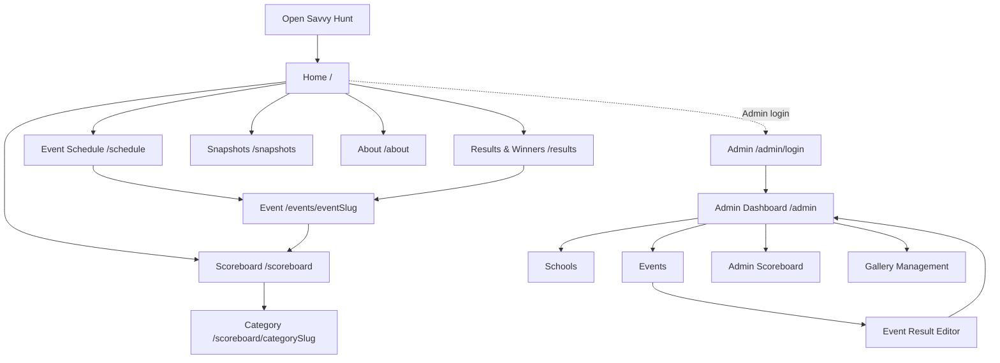
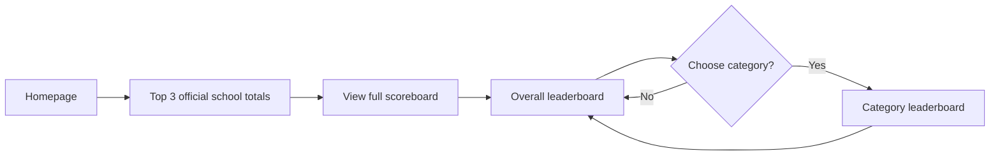
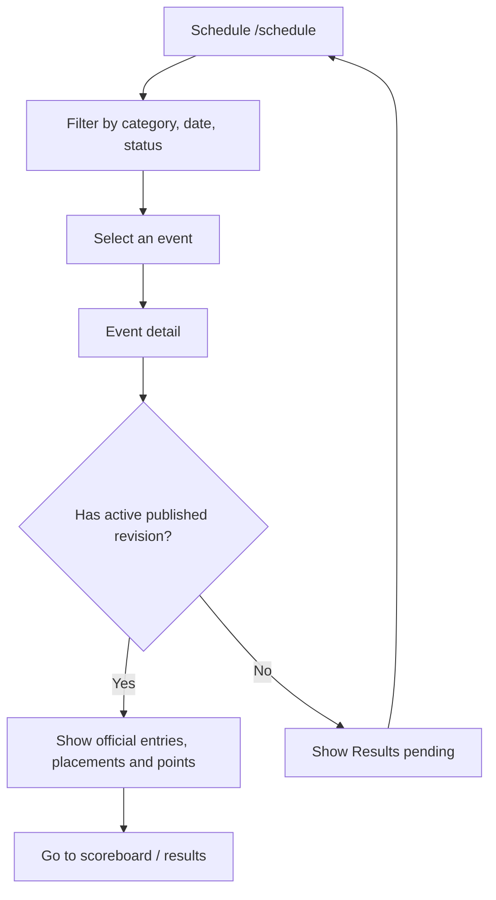
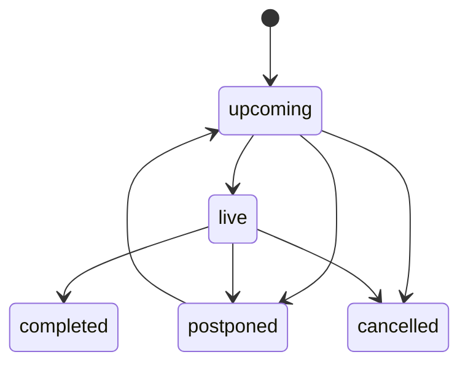
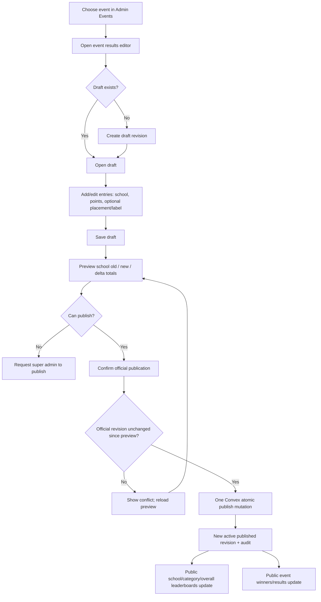
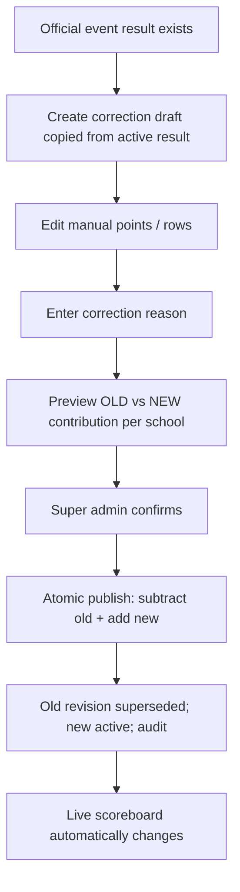
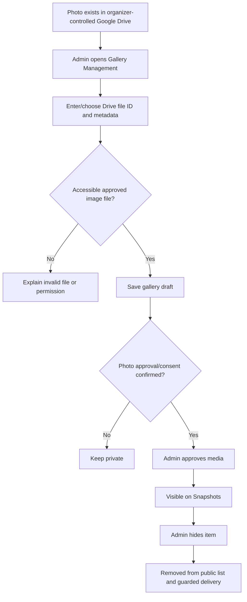

# Savvy Hunt — App Flow, Screen Map & State Transitions

**File:** `appflow.md`  
**Status:** Coding-agent UX/workflow contract for MVP  
**Updated:** 28 October 2026  
**Related docs:** [`prd.md`](./prd.md) · [`database.md`](./database.md) · [`techspc.md`](./techspc.md) · [`architectur.md`](./architectur.md)

> **One-sentence flow:** Visitors browse live event status and published results; admins create schools/events and **manually enter event points in drafts**; an authorized publication changes the official Convex result, which **automatically updates public school/category leaderboards in real time**.

## 1. Navigation at a glance



**Official category filters:** Category I, Category II, Category III, Category IV, Category V, and Common Category.

**Navigation design default:** Public navigation remains visible across public routes. Admin navigation is a separate sidebar/topbar. Public links never require sign-in; access to admin routes requires auth and an active allowlisted role.

## 2. Roles and permissions

| Workflow | Visitor | Editor (default) | Super admin (default) |
|---|---:|---:|---:|
| Read public pages | Yes | Yes | Yes |
| Create/edit/archive schools | No | Yes | Yes |
| Create/edit events and set live status | No | Yes | Yes |
| Create/edit result drafts | No | Yes | Yes |
| Preview publication effect | No | Yes | Yes |
| **Publish/revoke official result** | No | No | Yes |
| Add/approve/hide approved gallery items | No | Yes | Yes |
| Manage admins/site settings | No | No | Yes |
| Full audit log | No | No | Yes |

**Permission rule:** Every backend operation rechecks privileges. A disabled button or hidden route is not a security boundary.

## 3. Public visitor journeys

### 3.1 Homepage → Who's Leading? → Full Scoreboard



**Homepage includes (working design default):** Savvy Hunt hero, next/live events, top three schools, latest officially published results, and snapshots preview. Data must come from Convex, never from hardcoded production arrays.

**Scoreboard interactions:**
1. Open `/scoreboard`; see schools sorted by total official points and rank.
2. Select a category tab → navigate to `/scoreboard/[categorySlug]` (or preserve shareable URL).
3. Read only that category's totals and relevant published results.
4. Select **All Schools / Overall** → return to overall standings.
5. When an admin publishes/corrects/revokes results, table/top three update through Convex subscriptions without page refresh.

**States:** No schools → “Participating schools will appear here.” No scores → schools display **0**, not fake results. Equal scores → equal ranks; school name may stabilize order but is **not** a tie-breaker. Common Category is a sixth distinct filter, counted once in overall.

### 3.2 Schedule → Event Detail → Official Results



**Event status display (organizer-controlled):**
- **Upcoming:** scheduled; show date/time and category.
- **Live:** active; show prominent LIVE status, but do not imply points have been published.
- **Completed:** finished; show official winners **only if** published; otherwise “Results pending.”
- **Postponed:** state changed; explain updated schedule if available.
- **Cancelled:** clearly labeled; do not fabricate results or erase official history.

**Date display:** Store in UTC milliseconds, display in the edition's timezone (working default `Asia/Kolkata`). Do not silently infer live status from system clock.

### 3.3 Results → Winners

1. Open `/results` to view most recent officially published event results.
2. Filter by category/event when supported.
3. Select result → `/events/[eventSlug]`.
4. See the official school entries, optional **approved** placements and point values.
5. Participant names remain hidden unless explicitly approved; admin-only remarks never appear.

**Important:** Do not derive “1st place” merely because a school earned the largest point value; placement is an independently entered field.

### 3.4 Snapshots gallery

1. Visitor opens `/snapshots`.
2. Convex query returns only items with `approvalStatus=approved` **and** `consentConfirmed=true`.
3. Open photo/detail view with caption and alt text; optional link to relevant event.
4. If photo is unavailable, show a placeholder and keep page usable.
5. When admin hides an image, it disappears from public lists and its delivery endpoint must stop providing it according to the configured cache/takedown policy.

## 4. Admin sign-in and authorization flow

```mermaid
flowchart TD
    START[Visit /admin] --> LOGGED{Authenticated?}
    LOGGED -- No --> LOGIN[/admin/login]
    LOGIN --> PROVIDER[Supported sign-in provider]
    PROVIDER --> LOGGED
    LOGGED -- Yes --> ALLOW{Active admin allowlist?}
    ALLOW -- No --> DENIED[Access denied; do not show admin data]
    ALLOW -- Yes --> DASH[Dashboard]
    DASH --> CAP{Requested action permitted for role?}
    CAP -- No --> DENIED
    CAP -- Yes --> ACTION[Open manager or submit Convex mutation]
```

**States that must be distinct:** `auth-loading`, `unauthenticated`, `authenticated-not-allowlisted`, `forbidden-role`, `authorized`. Never show a success state solely because the browser has an email/session; Convex authorizes operations.

**Open decision:** Identity provider not chosen; follow `techspc.md` integration requirements and don't invent insecure shared-password auth.

## 5. Admin: add/edit/archive a school

```mermaid
flowchart TD
    A[Dashboard] --> LIST[/admin/schools]
    LIST --> ADD[Add school]
    ADD --> FORM[Name and optional code/logo]
    FORM --> VALID{Valid and unique?}
    VALID -- No --> ERR[Show inline error; keep values]
    ERR --> FORM
    VALID -- Yes --> CREATE[Authorized Convex create]
    CREATE --> NEW[School appears with 0 points]
    LIST --> EDIT[Edit school]
    EDIT --> UPDATE[Save name/details; keep stable ID]
    LIST --> ARCHIVE[Archive school with confirmation]
    ARCHIVE --> HISTORY[Preserve historical published contributions]
```

**Form requirements:** School name required; trim whitespace; reject empty or duplicate code; show loading and result. Archive is reversible by privileged policy (pending), and **never** delete published result entries. Active school leaderboard behavior is as in `prd.md`/`database.md`.

## 6. Admin: create or manage an event

### 6.1 Create event

1. Open `/admin/events` → **Create Event**.
2. Enter title, choose one of six categories, start time, optional end/venue/description.
3. Submit; Convex checks role, edition ownership, unique slug and valid times.
4. New event appears on admin list and public schedule with `upcoming` status (working default).
5. If any required input is invalid, show field-specific error without losing entered data.

### 6.2 Event status lifecycle



**Status changes are deliberate admin actions.** Do not auto-mark `live` from wall-clock time. This diagram shows common UI transitions; any extra transitions (e.g. completed → reopened) need an explicit privileged/recovery policy. Published results are independent of event status and must not be erased by status edits.

**Guard:** Changing category on an event that has an official published revision is forbidden in ordinary editing. If operationally necessary, require a special atomic migration with audit; not part of routine MVP flows.

## 7. Admin: manual scoring → publish (critical path)



### Scoring editor fields

| Field | Required? | Behavior |
|---|---|---|
| Event | Yes | Selected before drafting; category inherited from event. |
| School | Yes per row | Choose existing school from this edition. |
| Manual points | Yes per row | Validate finite nonnegative integer (working default). |
| Placement | No | Explicit placement if approved; do not auto-calculate winner. |
| Entry label | No | Safe anonymous label for participant/team/award if needed. |
| Participant name | No | Private by default; require explicit public permission. |
| Internal note | No | Visible to authorized admins only. |

**Valid example (illustrative, not official):** Event in Category III has School A: 5, School B: 3. On publish, Category III totals and overall school totals increase by 5 and 3 respectively. Neither change occurs when draft is merely saved.

### Buttons and exact semantics

| Control | Effect |
|---|---|
| **Save Draft** | Writes draft only; no public change. |
| **Add Result Row** | Adds one editable entry to draft. |
| **Remove Result Row** | Removes a draft entry only. |
| **Preview Publication** | Read-only computed change; include current official revision version. |
| **Publish Official Results** | Privileged confirmation → single backend mutation; display success only after committed. |
| **Create Correction** | Copies current active result to a new draft. |
| **Revoke Official Result** | Super-admin-only, requires reason, auditable removal of contributions. |

### States & error responses

- **Draft saved:** display “Draft saved — not visible to visitors.”
- **Published:** display “Official results published.” after backend confirms success.
- **Already published:** harmless no-op; do not re-add scores.
- **Stale preview:** display “Official result changed. Refresh and review differences before publishing.”
- **Missing school/invalid points:** inline validation; mutation rejected.
- **Not authorized:** show no publish action or clear role limitation; backend still rejects it if called.
- **Network uncertain:** check official backend state before retrying; never claim success early.

## 8. Admin: correction and revoke

### 8.1 Correct published points



**Critical rules:** Published rows are immutable. Correction drafts remain invisible to spectators while the previous published revision stays official. A correction from 8 → 11 applies **+3**, not +11. If a school entry is removed, its old points must be subtracted.

### 8.2 Revoke a result

1. Super admin opens published event → **Revoke**.
2. Confirm with **required reason**.
3. One backend transaction removes all active contributions, clears active published pointer and records audit/revocation.
4. Public results change to **Results pending** if no other active official revision; leaderboards update live.
5. Repeating revoke is either a safe no-op or a clearly handled already-revoked response; never subtract twice.

## 9. Admin: gallery approval flow



- **MVP default:** Admin curates previously uploaded Drive files; the site does not directly upload binaries to Drive.
- A gallery entry needs alt text. Consent confirmation is a checkpoint, not a substitute for following the school's image policy.
- Avoid exposed Drive credentials or a public proxy that can fetch arbitrary file IDs.
- If reliable image delivery isn't configured, show curated links/placeholder rather than broken or falsely functioning images.

## 10. UI state matrix for implementation

| Screen | Loading | Empty | Success | Error/recovery |
|---|---|---|---|---|
| Homepage | Skeleton for leaderboard/events | No live events yet | Live results from Convex | Reconnecting indicator. |
| Overall scoreboard | Placeholder table | No schools / zero totals | Rank + points updated reactively | Retry/reconnect; no fake score. |
| Category scoreboard | Placeholder | Category valid, no scores yet | Accurate filtered totals | Invalid slug → not found. |
| Schedule | Event placeholders | No matching events | Event list filtered by real status | Reset filters / reconnect. |
| Event detail | Detail skeleton | No active published revision | Official winners and points | Missing event → not found. |
| Admin school form | Submit progress | List can be empty | Toast + new school visible | Duplicate/unauthorized fields. |
| Admin result editor | Load draft & official | No draft: offer Create Draft | Save as draft, preview, publish | Invalid rows / stale preview. |
| Gallery | Image grid skeleton | No approved images | Captioned approved photos | Broken image fallback. |

**Accessibility:** Keep labeled forms, proper headings, clear button verbs, focus management for modals, and textual `LIVE`/status badges; avoid communicating results solely by colors or animation.

## 11. Cross-route reactive update contract

| Backend change | Public screens that must refresh automatically |
|---|---|
| Admin creates school | `/scoreboard`, category boards, relevant home leader summaries. |
| Admin starts/completes event | `/`, `/schedule`, `/events/[eventSlug]`. |
| Admin saves result draft | **No public result/score change.** |
| Admin publishes result revision | `/`, `/scoreboard`, category route, `/events/[eventSlug]`, `/results`. |
| Admin publishes correction | Same as publish, reflecting net delta. |
| Admin revokes result | Same as publish, removing old official points/winners. |
| Admin approves/hides gallery item | `/snapshots` and any homepage gallery preview. |

**Implementation:** Convex reactive subscriptions in client components; no polling or forced full reload to see official updates. State should be consistent across several connected spectators.

## 12. Build and test this flow first

**Primary E2E scenario (Definition of Done for scoring MVP):**

1. Authenticate as an allowlisted super admin.
2. Create `Demo School A` and `Demo School B` in **development only**.
3. Create `Demo Quiz` in Category II (development fixture).
4. Create a result draft and enter A = 10, B = 6 points.
5. Open `/scoreboard` in a separate anonymous browser session. Verify totals remain **0** before publication.
6. Preview, confirm, publish. Anonymous browser updates to A = 10, B = 6 (Category II **and** overall) without refresh.
7. Create correction draft, change A to 8, leave B at 6, provide reason and publish.
8. Verify A becomes **8**, B remains **6**, no double counting; audit shows both publications.
9. Re-publish active revision; totals unchanged.
10. Revoke with reason; official totals return to 0; event detail displays **Results pending**.
11. Attempt same workflows as anonymous/non-allowlisted/editor account; prohibited operations are rejected server-side.
12. Verify Common Category entries contribute once to overall and do not appear in Category I–V filtered scores.

**Release constraint:** Never seed this development scenario in production.

## 13. Remaining UX decisions (not blockers for coding scaffolds)

- Exact reference-site look versus new design, school-provided branding and logos.
- Placement/medal tie policy, whether to show more than three tied schools in the home widget.
- Participant display-name consent and official photo publication procedure.
- Auth provider/admin roster; edit/publish role split is a default.
- Direct Drive upload (Phase 2) versus approved existing Drive links (MVP default).
- Event schedule and venue details; use editable data rather than hardcoded dates.

## 14. Coding-agent instruction

> Implement the flows in this document in dependency order. Begin with one fully functional admin-to-public scoring workflow. Every public score or winner must come from the event's active published revision in Convex. Always show separate states for draft, official, pending, unauthorized and stale. Do not assume an event being live or completed means results are published. Use `database.md` for field/transaction rules, `techspc.md` for service boundaries, and `prd.md` for acceptance. After each feature, validate both an authorized admin flow and anonymous public behavior.
