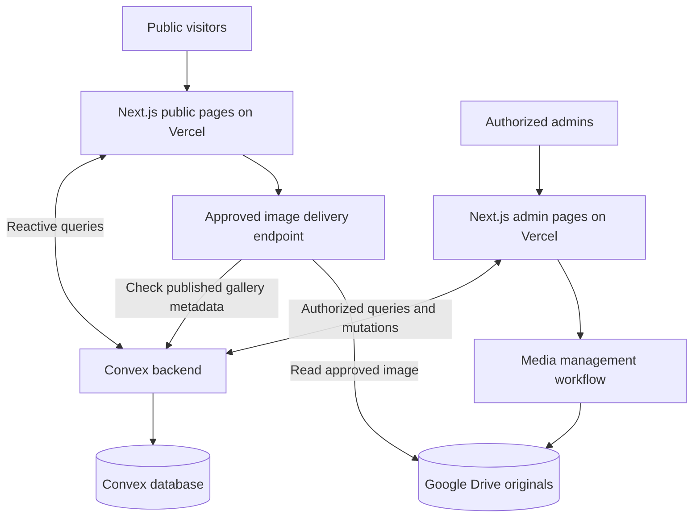
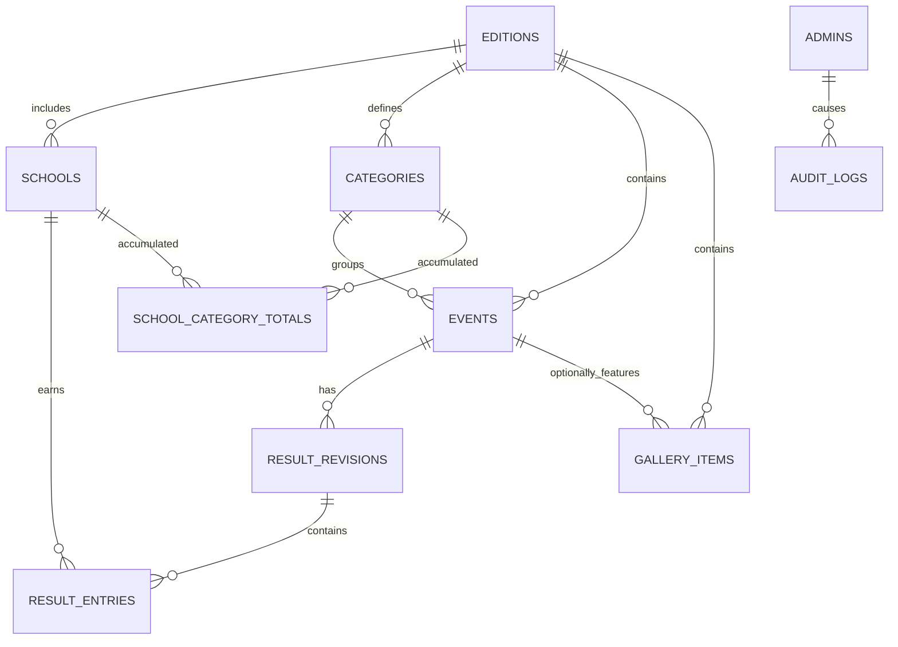

# SAVVY HUNT — Coding Agent Architecture

**File:** `architectur.md`  
**Version:** 1.0 — 28 October 2026  
**Project:** Savvy Hunt school event website  
**Reference:** https://github.com/roohiiiit/Savvy-Hunt/tree/main/Savvy-Hunt  
**Product specification:** [`plan.md`](./plan.md)

> **For coding agents:** Read this file before changing code. `plan.md` defines feature scope; **this file defines implementation boundaries and data flow**. If an unconfirmed choice affects implementation, flag it rather than pretending the school decided it. Build one working vertical slice at a time.

---

## 1. Project in one minute

Savvy Hunt is a public, real-time scoreboard and school event website with a restricted admin dashboard.

**Visitors can:**
- See overall **school-wise** points and rankings.
- Filter scores/results by **category**.
- See upcoming, live, completed events and published winners.
- See **Who's Leading?** (top three schools).
- Browse approved event **snapshots / gallery**.

**Admins can:**
- Add, edit and archive participating **schools**.
- Create and manage **events**, assign one category, and control live status.
- Enter **manual points per event**; preview, publish, and correct official results.
- Review the scoreboard and each school's score contributions.
- Approve, publish, hide and manage **Google Drive photos**.

### Locked requirements

| Item | Rule |
|---|---|
| Stack | Next.js App Router, TypeScript, Convex, Vercel, Google Drive |
| Categories | Category I, II, III, IV, V, **Common Category** |
| Schools | Admin-created; never hardcoded into frontend source |
| Points | **Event-based manual scoring**; no automatic fixed award values |
| Official totals | Automatically derived from **active published event results only** |
| Real-time | Convex subscriptions; visitors do not manually refresh to see published changes |
| Source of truth | Convex for structured data and totals; Drive for photo originals |

### Working defaults — NOT confirmed by school

- Mobile-first modern design based on the reference repo, not a literal rewrite.
- No login required for public pages; admins are authenticated and allowlisted.
- Six categories are seeded per edition; scores are nonnegative **integers** until official point policy changes.
- Publish requires explicit confirmation; typing a score never updates public totals.
- Admin roles: `super_admin` and `editor`; only `super_admin` publishes by default.
- Snapshots means approved photos; direct upload from the website is **Phase 2**.
- Dates, venues, branding, participant-name permissions, and actual audience size remain open.

**Agent rule:** Do not invent school names, participant names, event results, date, points policy, or domain. Use clearly labeled development fixtures only in development.

---

## 2. System context



### Service responsibilities

| Service | Owns | Must NOT own |
|---|---|---|
| **Next.js** | Routes, UI, forms, layouts, image delivery adapter | Authoritative scoring logic |
| **Convex** | Schools, events, drafts, publication, score totals, permissions, audit, gallery metadata | Photo binary archive |
| **Google Drive** | Photo original files owned by school/organizers | School scores or event states |
| **Vercel** | Hosting, deployment, route handlers, secrets for server-only adapters | Database truth |
| **Auth integration** | Identity/session; Convex authorization checks access | Trusting a hidden admin button as a permission check |

**Do not:** connect to Supabase just because the reference HTML does, poll Convex with `setInterval`, calculate official totals only in the browser, or put Google credentials in client bundles.

---

## 3. App routes and ownership

### Public routes

| URL | Data source | UI |
|---|---|---|
| `/` | `scoreboard.getTopThree`, `events.listPublic`, `results.listRecentPublished`, `siteSettings.getPublic` | Hero, top 3, live, upcoming, recent results |
| `/scoreboard` | `scoreboard.getOverall` | Overall school leaderboard + category tabs |
| `/scoreboard/[categorySlug]` | `scoreboard.getCategory` | One category leaderboard and recent results |
| `/schedule` | `events.listPublic` | Upcoming / Live / Completed + filters |
| `/events/[eventSlug]` | `events.getPublicBySlug`, `results.getPublishedByEvent` | Event detail, status, official winners |
| `/results` | `results.listRecentPublished` | Official result history |
| `/snapshots` | `gallery.listApproved` | Approved photo grid and filters |
| `/about` | `siteSettings.getPublic` | School-approved event information |

### Admin routes

| URL | Purpose |
|---|---|
| `/admin/login` | Sign in (provider determined before auth implementation) |
| `/admin` | Dashboard / work queue |
| `/admin/schools` | Create, edit, archive schools |
| `/admin/events` | Create and manage events |
| `/admin/events/[id]/results` | Create draft, edit manual points, preview, publish/correct |
| `/admin/scoreboard` | Inspect official totals and source contributions |
| `/admin/gallery` | Review and publish Drive-linked photos |
| `/admin/settings` | Edition and site settings |
| `/admin/audit` | Permission-gated change log |

**UI convention:** Keep `page.tsx` small; call reusable feature components. Use `useQuery` / `useMutation` inside client components for live data. Server Components are appropriate for static shells, metadata and preloading where supported; they do **not** replace client subscriptions.

---

## 4. Recommended folder structure

```text
savvy-hunt/
├── app/
│   ├── layout.tsx                   # Root providers, global layout
│   ├── providers.tsx                # Client-side Convex + auth providers
│   ├── (public)/
│   │   ├── layout.tsx               # Public header/footer
│   │   ├── page.tsx                 # Homepage /
│   │   ├── scoreboard/
│   │   │   ├── page.tsx
│   │   │   └── [categorySlug]/page.tsx
│   │   ├── schedule/page.tsx
│   │   ├── events/[eventSlug]/page.tsx
│   │   ├── results/page.tsx
│   │   ├── snapshots/page.tsx
│   │   └── about/page.tsx
│   ├── admin/
│   │   ├── layout.tsx
│   │   ├── login/page.tsx
│   │   ├── page.tsx
│   │   ├── schools/page.tsx
│   │   ├── events/page.tsx
│   │   ├── events/[id]/results/page.tsx
│   │   ├── scoreboard/page.tsx
│   │   ├── gallery/page.tsx
│   │   ├── settings/page.tsx
│   │   └── audit/page.tsx
│   └── api/
│       └── gallery/[itemId]/image/route.ts  # Only if Drive image proxy implemented
├── components/
│   ├── ui/                          # Button, Dialog, Input, Table, Badge
│   ├── layout/                      # Header, Footer, AdminSidebar
│   ├── scoreboard/                  # Leaderboard, TopThree, ScoreBreakdown
│   ├── events/                      # EventCard, StatusBadge, Timeline
│   ├── results/                     # ResultEditor, PublishPreview, WinnerList
│   ├── schools/                     # SchoolForm, SchoolList
│   └── gallery/                     # GalleryGrid, PhotoForm
├── convex/
│   ├── schema.ts
│   ├── auth.config.ts              # Only if required by chosen auth integration
│   ├── editions.ts
│   ├── categories.ts
│   ├── schools.ts
│   ├── events.ts
│   ├── results.ts
│   ├── scoreboard.ts
│   ├── gallery.ts
│   ├── admins.ts
│   ├── siteSettings.ts
│   ├── audit.ts
│   └── lib/
│       ├── permissions.ts          # Require signed-in active admin + capability
│       ├── scoring.ts              # Pure aggregation/delta/ranking helpers
│       └── validation.ts           # Input and cross-edition checks
├── lib/
│   ├── constants.ts                 # Labels, UI constants (not school list)
│   ├── format.ts                    # Timezone, points display
│   └── drive.server.ts              # Server-only; never import into client UI
├── scripts/
│   └── seed.ts                       # Development seed + idempotent category setup
├── tests/
│   ├── unit/scoring.test.ts
│   ├── integration/results.test.ts
│   └── e2e/official-results.spec.ts
├── public/                           # School-approved static assets only
├── .env.example
├── plan.md
├── architectur.md
└── README.md
```

`convex/_generated/` is generated by Convex tooling. Never hand-write or edit its contents. Additional files created by auth setup may differ depending on selected provider.

---

## 5. Database diagram



### Core Convex collections

| Table | Required fields (plus Convex `_id`, `_creationTime`) | Important index |
|---|---|---|
| `editions` | `name`, `slug`, `year`, `timezone`, `status`, `isCurrent` | `by_slug`, `by_current` |
| `schools` | `editionId`, `name`, `status`, `createdAt`, `updatedAt` | `by_edition`, `by_edition_code` if codes used |
| `categories` | `editionId`, `name`, `slug`, `sortOrder`, `isActive` | `by_edition_slug` |
| `events` | `editionId`, `categoryId`, `title`, `slug`, `startsAt`, `status`, `resultStatus`, `activePublishedRevisionId?` | `by_edition_start`, `by_edition_status`, `by_edition_slug` |
| `resultRevisions` | `eventId`, `revisionNumber`, `status`, `createdBy`, `createdAt`, `publishedAt?`, `changeReason?` | `by_event`, `by_event_status` |
| `resultEntries` | `revisionId`, `eventId`, `schoolId`, `points`, `placement?`, `entryLabel?`, `sortOrder` | `by_revision` |
| `schoolCategoryTotals` | `editionId`, `schoolId`, `categoryId`, `points`, `updatedAt` | `by_edition_category`, `by_edition_school`, `by_school_category` |
| `galleryItems` | `editionId`, `driveFileId`, `altText`, `approvalStatus`, `consentConfirmed`, `createdAt` | `by_edition_status`, `by_event_status` |
| `admins` | `authUserId`, `role`, `isActive`, `createdAt` | `by_auth_user_id` |
| `auditLogs` | `actorAuthUserId`, `action`, `entityType`, `entityId`, `createdAt`, `summary` | `by_created_at`, `by_entity` |
| `siteSettings` | `editionId`, `eventTitle`, `updatedAt` | `by_edition` |

**Use real Convex `Id<"table">` references** for relationships. Add `v` validators, optional fields and precise indexes in `convex/schema.ts`; the table above is a **design map**, not copy-paste schema syntax.

### Key modeling rules

1. **Edition isolation:** every school, category, event and public total belongs to the same `editionId`. Validate cross-table relationships in every mutation.
2. **One category per event.** Result entries inherit category through their event; they never choose a second category.
3. **Many entries per school per event are valid**, if several students/teams earn awards. Don't enforce one entry per school/event.
4. **One active published revision per event:** store its ID on the event. Draft/historical revisions must not contribute.
5. **Categories are database rows, not TS enums**; seed the six specified names/ordered slugs. Avoid changing an event's category after publication in regular edit flow.
6. **Totals are maintained on publish, not edited by admins.** Ensure one logical total document per `(editionId, schoolId, categoryId)` and guard all upserts in transactional mutations.
7. Use nonnegative integer `points` as a **temporary policy**; confirm support for penalties, fractions and point caps before production.
8. School references stay stable if the school's display name changes. Published results should be archived/corrected, not cascade-deleted.
9. Participant/team names are optional and **not public** without school approval. Prefer school-only display for MVP.

---

## 6. Exact scoring contract (most important)

### Formula

```text
CategoryTotal(school, category)
  = SUM(points for entries from the event's active published revision,
        where entry.schoolId = school AND event.categoryId = category)

OverallTotal(school)
  = Category I + Category II + Category III
  + Category IV + Category V + Common Category
```

`Common Category` is counted **once** in overall and has its own filtered leaderboard; it is **not** merged into every other category.

### Status machines

```text
Event status:    upcoming -> live -> completed
                            \-> cancelled/postponed (controlled)

Result status:   none -> draft -> published
                         published -> correction draft -> replaced published revision
                         published -> revoked (with reason)
```

Event completion and result publication are independent. A completed event with no published result displays **"Results pending"**.

### Publishing — one Convex mutation

```mermaid
sequenceDiagram
    participant Admin
    participant UI as Results editor
    participant API as Convex publishRevision
    participant DB as Convex DB
    participant Live as Public reactive queries
    Admin->>UI: Review event result draft
    UI->>API: Publish revision with confirmation
    API->>DB: Verify identity, permissions, revision and entries
    API->>DB: Calculate old and new school contributions
    API->>DB: Update totals by DELTA; switch active revision; write audit
    DB-->>API: Transaction committed
    API-->>UI: Published success
    DB-->>Live: Reactive query invalidation/update
```

**Pseudocode (authoritative behavior, not literal implementation):**

```ts
publishRevision(eventId, draftRevisionId, expectedActiveRevisionId) {
  requirePermission("publish_results");
  const event = loadEvent(eventId);
  const draft = loadDraftForEvent(draftRevisionId, eventId);
  validatePointsSchoolsEditionAndRows(draft);

  if (event.activePublishedRevisionId === draftRevisionId) {
    return { status: "already_published" }; // idempotent
  }
  if (event.activePublishedRevisionId !== expectedActiveRevisionId) {
    throw Conflict("Another admin changed the official result. Refresh preview.");
  }

  const oldBySchool = groupPoints(event.activePublishedRevisionId); // or {}
  const newBySchool = groupPoints(draftRevisionId);

  for (const schoolId of union(oldBySchool, newBySchool)) {
    const delta = (newBySchool[schoolId] ?? 0) - (oldBySchool[schoolId] ?? 0);
    applyDelta(event.editionId, schoolId, event.categoryId, delta);
  }

  supersedeOldRevisionIfPresent();
  markNewRevisionPublished();
  setActivePublishedRevisionOnEvent(draftRevisionId);
  appendAuditLog();
  return { status: "published" };
}
```

**Critical implementation note:** All reads/writes above happen in **one Convex mutation/transaction**. The functions `groupPoints`/`applyDelta` stand for backend helpers using `ctx.db`, not calls to separate independently committed public mutations.

### Editing and corrections

1. Admin edits **draft** result entries. Nothing public changes.
2. Preview shows **per-school old → new → difference** before confirmation.
3. On publish, swap one published revision for the new revision **atomically**.
4. Edits to an already-published revision are forbidden. Copy it to a correction draft.
5. Revoke published results only with permission + reason; subtract active contributions in one transaction, then clear `activePublishedRevisionId`.
6. Repeated publication must not add points twice.
7. Concurrent publishes must compare against the **expected active revision**, and stale operations must fail safely.
8. Audit who/when/why for publish, correction, revoke.

### Ranking and top-three

- Rank by points **descending**; equal points receive the **same numeric rank** (`1, 1, 3`).
- Alphabetical school order may stabilize display only; it does not break a tie.
- Show active schools with zero points.
- The homepage top-three component shows up to 3 **distinct school cards**, with ties visibly labeled; if more schools tie at the cut-off, indicate additional tied schools rather than pretending someone won outright.
- For category leaderboard, sort using **only that category's points**.

### Query performance

Read `schoolCategoryTotals` using indexed queries; sum up to six category rows per school in the overall query. Do **not** read every `resultEntries` row on every public leaderboard subscription. Provide a restricted `reconcileTotals` maintenance operation comparing aggregates with currently active revisions.

---

## 7. Convex API boundaries

### Public queries — no authentication

```text
editions.getCurrent()
categories.listCurrent({ editionId })
schools.listActive({ editionId })
events.listPublic({ editionId, categoryId?, status?, cursor? })
events.getPublicBySlug({ editionSlug?, eventSlug })
results.getPublishedByEvent({ eventId })
results.listRecentPublished({ editionId, limit })
scoreboard.getOverall({ editionId })
scoreboard.getCategory({ editionId, categoryId })
scoreboard.getTopThree({ editionId })
gallery.listApproved({ editionId, eventId?, cursor? })
gallery.getPublicImageSource({ itemId })        # Approved-only metadata for image route
siteSettings.getPublic({ editionId })
```

Every public query must return only approved/published fields. Do not leak unpublished results, participant names without permission, unpublished photos, private notes, tokens, or admin records.

### Admin-only queries

```text
admins.getMyRole()
admin.dashboardSummary({ editionId })
schools.listForAdmin({ editionId })
events.listForAdmin({ editionId })
results.getDraft({ eventId })
results.previewPublication({ eventId, draftRevisionId })
scoreboard.getContributionBreakdown({ editionId, schoolId })
audit.listForAdmin({ editionId, cursor? })
```

### Mutations

```text
schools.create / schools.update / schools.archive
events.create / events.update / events.setStatus / events.cancel
results.createDraft / results.upsertDraftEntry / results.deleteDraftEntry
results.publishRevision / results.revokePublished
gallery.addDriveFile / gallery.updateMetadata / gallery.publish / gallery.hide
admins.changeRole / admins.revoke           # super_admin only
siteSettings.update                         # super_admin only
```

`results.previewPublication` must calculate old/new contributions from drafts and the active revision **without changing the database**. It is an authorized query, but publication must revalidate everything in its mutation, since the preview can become stale.

### Security helper pattern

```ts
// Conceptual only — adapt to selected auth provider.
async function requireAdmin(ctx, requiredCapability) {
  const identity = await ctx.auth.getUserIdentity();
  if (!identity) throw new Error("Authentication required");
  const admin = await lookupActiveAdminByAuthSubject(ctx, identity.subject);
  if (!admin || !roleAllows(admin.role, requiredCapability)) {
    throw new Error("Insufficient permissions");
  }
  return admin;
}
```

Use `requireAdmin()` **inside every sensitive Convex query/mutation/action**, not solely in Next.js route guards. For a server-side Drive operation, verify the admin's identity using a **supported, token-verified server integration**; do not trust `adminId` supplied by the browser.

**Auth implementation decision:** Convex Auth is available but its Next.js SSR/Route Handler support is still experimental. Preferred MVP is **client-side admin UI with Convex-authorized backend operations**, after selecting a supported auth provider. Avoid implementing admin upload via Next.js until its token/session verification is tested. If robust server-side auth is essential, request approval for a supported hosted provider such as Clerk instead of inventing custom credentials.

---

## 8. Frontend component rules

### Data flow per page

```text
Server-rendered page/layout shell
      -> small client component
      -> useQuery(api.scoreboard.getOverall, { editionId })
      -> loading / empty / data / error UI
      -> Convex automatically streams updated query result
```

- `useMutation` calls happen only after real user actions (save, publish, hide).
- Show explicit **Saving**, **Publishing**, **Published** and failure states.
- Do not optimistically display new official points before the backend confirms publication.
- A score draft can have locally edited form state. Saving a draft does not mean public publication.
- Keep event/category/school entity IDs in state; never use display names as database keys.
- Format event times for `Asia/Kolkata` by default; store UTC timestamps in the database.
- Use accessible labels, keyboard support, mobile-friendly tables and meaningful empty states.
- Route components should not contain scoring math or direct Google Drive access code.

### Important reusable components

| Component | Responsibility |
|---|---|
| `LeaderboardTable` | Rank, school, points, category toggle |
| `TopThree` | Official top 3 with tie handling |
| `CategoryFilter` | All 6 category selectors |
| `EventCard` | Name, venue/time, status, results link |
| `ResultsEditor` | Rows: school, entry label, placement, manual points |
| `PublicationPreview` | Old points, new points, delta, confirmation |
| `ResultStatusBadge` | Draft / Official / Pending, no ambiguity |
| `GalleryGrid` | Approved media only; fallbacks for missing images |
| `AdminSidebar` | Navigation; not a security boundary |

---

## 9. Google Drive gallery integration

### MVP — curated Drive files

1. School/organizer owns an approved Drive folder.
2. Organizer uploads photo originals to that folder.
3. Admin enters or selects an approved Drive **file ID** in `/admin/gallery`.
4. Server validates file type, authorized ownership/folder access, and metadata before allowing publication (if Drive API credentials are configured).
5. Admin records caption, meaningful `altText`, optional `eventId`, and `consentConfirmed`.
6. Only `approvalStatus = approved` **and** `consentConfirmed = true` can be returned publicly.
7. Hiding a gallery item removes it from approved public queries; direct external/public Drive URLs cannot necessarily be revoked by removing it from the gallery.

### Image delivery (only after verifying Drive credentials and access)

```text
GET /api/gallery/:itemId/image
  -> Look up APPROVED gallery item via Convex public-approved query
  -> Reject if hidden/not approved/not consented
  -> Read only that item's Drive file server-side
  -> Validate content type and size
  -> Return image with an explicit caching/privacy policy
```

For MVP, favor **no-store or very short cache** if rapid hide/takedown matters; assess Vercel bandwidth and Drive quotas before enabling high-traffic gallery views. A public share link or Drive thumbnail URL is **not** a guaranteed image CDN. A proper image CDN is optional later and requires approval.

**Never:** expose folder contents through an unauthenticated listing, allow arbitrary `fileId` in a public proxy, or ship OAuth tokens/service keys to the browser. Initial gallery functionality may link to organizer-approved files until safe rendering is configured; do not fake a reliable image delivery mechanism.

---

## 10. Authentication, roles and data privacy

| Action | Visitor | Editor | Super admin |
|---|---|---|---|
| Read public content | Yes | Yes | Yes |
| Create schools/events | No | Yes | Yes |
| Edit result drafts | No | Yes | Yes |
| Publish/revoke results | No | No by default | Yes |
| Gallery curation | No | Yes | Yes |
| Manage admins/settings | No | No | Yes |
| View full audit history | No | Restricted | Yes |

- Admin access is an **allowlist**: successful sign-in alone does not create an administrator.
- Bootstrap the first super admin via a private, documented procedure.
- Avoid shared admin passwords, client-side role enforcement and publicly exposed privileged mutations.
- Never commit `.env.local`, Google tokens, authentication secrets or production IDs to GitHub.
- Collect as little student information as possible; student/team names and photos need explicit school approval before public display.

---

## 11. Deployment and environments

```text
Local development                  Production
----------------                  ----------
Next.js localhost                 Vercel production deployment
Convex DEV deployment             Convex PROD deployment
Test-only edition/schools         Official Savvy Hunt edition
Dummy result entries              Official published results
Test Drive folder (if used)       School-owned approved Drive folder
```

**Environment variable shape (names illustrative):**

```dotenv
# Safe for browser exposure
NEXT_PUBLIC_CONVEX_URL=

# Vercel server-only, if image proxy is implemented
GOOGLE_DRIVE_FOLDER_ID=
GOOGLE_CLIENT_ID=
GOOGLE_CLIENT_SECRET=
GOOGLE_REFRESH_TOKEN=

# Add provider-specific auth config after deciding integration.
# Never prefix credentials with NEXT_PUBLIC_.
```

- Keep dev and production Convex deployments separate.
- Set environment variables in the services that **actually execute** the code.
- Test production admin auth and Drive access on production domains.
- Maintain a documented rollback and event-day manual tally fallback.

---

## 12. Coding order — build a working vertical slice

**Phase A — foundation**

- [ ] Create Next.js App Router + TypeScript app.
- [ ] Connect to Convex; define schema and indexes.
- [ ] Create edition and six categories through an idempotent seed.
- [ ] Add shared UI primitives and a basic navigation layout.

**Phase B — secured master data**

- [ ] Implement authentication provider and active-admin authorization helper.
- [ ] Implement create/list/update/archive schools.
- [ ] Implement create/edit/status-change events.
- [ ] Render public schedule from actual Convex data.

**Phase C — scoring (build before visual polish)**

- [ ] Create result drafts and add/edit/delete manual score entries.
- [ ] Add publication preview: old/new/delta per school.
- [ ] Implement publish/replace/revoke **atomically** with audit records.
- [ ] Materialize school+category totals; create overall/category queries.
- [ ] Render reactive leaderboard, top three, and winners.
- [ ] Verify two browser tabs update on publication without refresh.

**Phase D — gallery and finishing**

- [ ] Register approved Google Drive media and add consent checks.
- [ ] Implement safe public image delivery or approved-file fallback.
- [ ] Complete gallery, mobile polish, accessibility, error/empty states.
- [ ] Run scoring/security/reliability tests and production rehearsal.

**Do not implement every route as static mocked screens and then add data later.** Finish one complete workflow before proceeding.

---

## 13. Mandatory tests and acceptance criteria

### Scoring tests

- [ ] School added by admin appears in the public scoreboard with zero points.
- [ ] Draft score saves **do not** change public totals.
- [ ] Publishing an event adds exactly its entries' points to that category and overall.
- [ ] Common Category contributes once to overall.
- [ ] Same school can legitimately receive multiple score entries in one event.
- [ ] Publish twice is idempotent.
- [ ] Correction subtracts old event points and adds replacement points exactly once.
- [ ] Revoke subtracts the active event's contributions once.
- [ ] Concurrency/stale publish fails safely with a useful error.
- [ ] Equal points produce equal ranks; no accidental winner from alphabetical order.
- [ ] Aggregates reconcile to active published revisions.

### Security and UI tests

- [ ] Public visitor cannot call any admin mutation.
- [ ] Authenticated user without active admin allowlist entry cannot call admin mutations.
- [ ] Editor cannot publish if role doesn't permit it.
- [ ] School/event/category cross-edition references fail validation.
- [ ] Public queries never return drafts, private notes or unapproved photos.
- [ ] After publish, two public clients update via Convex subscription without reload.
- [ ] Completed event without results says **"Results pending"**.
- [ ] Missing Drive image does not break the gallery UI.
- [ ] Mobile scoreboard and admin forms remain usable.

**Definition of done for scoring MVP:** Admin creates a school, creates an event, enters points in a draft, publishes official results, sees real-time school/category/overall updates, and successfully publishes a correction without double-counting. All restricted actions are authorized on the backend.

---

## 14. Decision log / questions to raise before high-impact implementation

| Open decision | Safe default until confirmed |
|---|---|
| Visual fidelity to GitHub reference | Modern redesign, preserve important sections |
| Identity provider | Use supported Convex-compatible auth; choose explicitly before login implementation |
| Admin roles and publisher list | `super_admin` publishes, `editor` enters drafts |
| Scoring allowed range | Nonnegative integers, manual per-entry points |
| Ties and medals | Equal points get equal ranks; do not invent a medals tie-breaker |
| Named individual/team winners | Optional, private unless approved |
| Gallery upload | Curated Drive file IDs first; website upload later |
| Image proxy cost / Drive permissions | Validate before relying on a public photo grid |
| Event dates, venue, branding | Admin-editable; no hardcoded production values |
| Number of concurrent visitors | Load-test before launch; no guarantee without measurements |

**Agent decision policy:** If a requested change contradicts locked requirements, explain the conflict before altering the architecture. For open decisions, apply a reversible default for local development, label it clearly, and never claim approval.

---

## 15. Official engineering references

- Next.js + Convex App Router: https://docs.convex.dev/client/nextjs/app-router/
- Convex realtime subscriptions: https://docs.convex.dev/realtime
- Convex database/indexes: https://docs.convex.dev/database/overview
- Convex auth overview: https://docs.convex.dev/auth/overview
- Convex Auth beta caveat: https://docs.convex.dev/auth/convex-auth
- Convex best practices: https://docs.convex.dev/understanding/best-practices
- Google Drive API: https://developers.google.com/workspace/drive/api/guides/about-files
- Vercel environment variables: https://vercel.com/docs/environment-variables

---

## 16. Agent instruction to copy into a coding session

> Read `architectur.md` and `plan.md` first. Build the Savvy Hunt application using Next.js App Router, TypeScript, Convex, Vercel and Google Drive. Follow the architecture's data model and permission boundaries. Prioritize a working end-to-end flow (create school → create event → save draft points → publish → reactive scoreboard → correction). Never hardcode school lists or official scores, never show drafts publicly, and never alter cumulative totals directly. Keep backend authorization and result publication atomic. Implement in small steps; after each step run typecheck/tests and report files changed, checks run, and unresolved blockers. Ask before introducing additional paid services or changing confirmed requirements.

**End of `architectur.md` — v1.0.**
