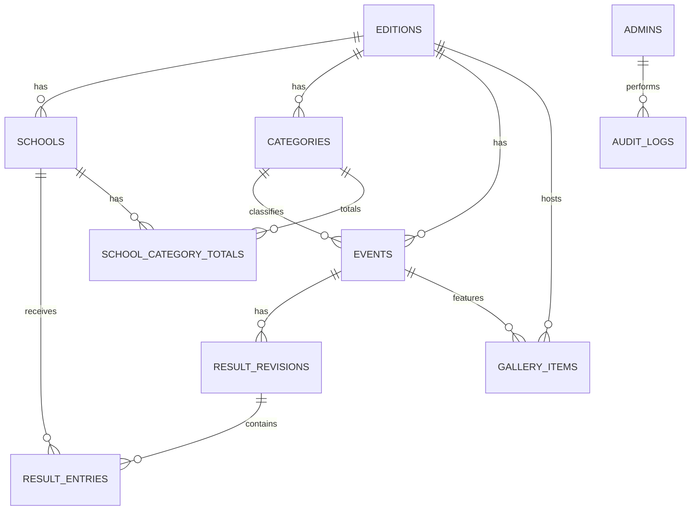

# Savvy Hunt — Database Design & Scoring Contract

**File:** `database.md`  
**Status:** Proposed implementable schema for Convex (MVP)  
**Updated:** 28 October 2026  
**Companion:** [`prd.md`](./prd.md) · [`techspc.md`](./techspc.md) · [`appflow.md`](./appflow.md) · [`architectur.md`](./architectur.md)

> **Non-negotiable:** Structured data and official score totals live in **Convex**. Manual event result rows are entered as drafts. **Only each event's active published revision contributes points.** Never let a client directly overwrite a school or category total.

## 1. Conventions

| Convention | Contract |
|---|---|
| IDs | Native Convex `Id<"table">` references; never string-join foreign keys. |
| Dates | UTC epoch milliseconds (`number`); format in chosen edition timezone in UI. |
| Labels | Human names are editable; references use IDs; URL slugs are stable and unique **within edition**. |
| Soft deletion | Archive schools/events where history exists; do not cascade-delete published scoring. |
| Validation | `v` argument/schema validators **plus business-rule checks** in every mutation. |
| Roles | Auth identity resolved on backend and mapped to active `admins` row. |
| Visibility | Public queries return only approved content/active published results. |
| Uniqueness | Convex indexes speed lookups; enforce logical uniqueness with read-and-check in transactions. |
| Score type | Finite nonnegative integer **working default**; policy may change before launch. |

**Reference values, not production facts:** `Category I`, `Category II`, `Category III`, `Category IV`, `Category V`, `Common Category`. Seed one of each for an edition. Suggested slugs: `category-i` through `category-v`, `common-category`.

## 2. Relationships



**Cardinality invariants:** One event → one category; one event → many revisions; one revision → many entries; one entry → one school; **one event → zero or one active published revision**; one logical cached total → one `(editionId, schoolId, categoryId)` tuple.

## 3. Tables (MVP canonical data dictionary)

Fields marked **required** must exist; `?` means optional. All tables implicitly have Convex `_id` and `_creationTime`. Use indexes named below; actual TypeScript `defineTable` implementation must conform to the installed Convex version.

### 3.1 `editions`

| Field | Type | Purpose |
|---|---|---|
| `name` | `string` required | Public edition name, e.g., a future organizer-provided label. |
| `slug` | `string` required | URL/internal edition key. |
| `year` | `number` required | School edition year. |
| `timezone` | `string` required | IANA timezone (default proposal: `Asia/Kolkata`). |
| `status` | `"draft" \| "active" \| "archived"` | Edition lifecycle. |
| `isCurrent` | `boolean` required | Only one current edition logically allowed. |
| `createdAt`, `updatedAt` | `number` required | Epoch ms. |

**Indexes:** `by_slug(slug)`, `by_current(isCurrent)`. Enforce one current edition via controlled admin/seed mutation.

### 3.2 `schools`

| Field | Type | Purpose |
|---|---|---|
| `editionId` | `Id<"editions">` required | Ownership. |
| `name` | `string` required | Admin-supplied school name. |
| `code` | `string?` | Optional unique short code per edition. |
| `status` | `"active" \| "archived"` required | Archive rather than delete scored schools. |
| `logoRef` | `string?` | Organizer-approved logo reference (implementation-defined). |
| `createdAt`, `updatedAt` | `number` required | Auditing and sorting. |

**Indexes:** `by_edition(editionId)`, `by_edition_code(editionId, code)` if codes used. Prevent duplicate normalized code; define name duplication policy with organizers.

### 3.3 `categories`

| Field | Type | Purpose |
|---|---|---|
| `editionId` | `Id<"editions">` required | Ownership. |
| `name` | `string` required | One of six official labels. |
| `slug` | `string` required | Stable URL value. |
| `sortOrder` | `number` required | Order I → V → Common. |
| `isActive` | `boolean` required | Keep category with published history even if hidden. |

**Indexes:** `by_edition_slug(editionId, slug)`, `by_edition_sort(editionId, sortOrder)`. Seed **idempotently**; do not duplicate categories during deploys.

### 3.4 `events`

| Field | Type | Purpose |
|---|---|---|
| `editionId` | `Id<"editions">` required | Ownership. |
| `categoryId` | `Id<"categories">` required | Exactly one category. |
| `title` | `string` required | Event name. |
| `slug` | `string` required | Unique within edition. |
| `description` | `string?` | Event information. |
| `venue` | `string?` | Location. |
| `startsAt` | `number` required | Schedule time (UTC epoch ms). |
| `endsAt` | `number?` | Must not precede start. |
| `status` | `"upcoming" \| "live" \| "completed" \| "postponed" \| "cancelled"` | Admin-controlled public event state. |
| `resultStatus` | `"none" \| "draft" \| "published"` | Display helper; MUST be consistent with active published revision. |
| `activePublishedRevisionId` | `Id<"resultRevisions">?` | **Only this revision counts.** |
| `isFeatured` | `boolean` required | Homepage highlighting. |
| `createdBy` | `string` required | Stable identity key for admin. |
| `createdAt`, `updatedAt` | `number` required | Audit timestamps. |

**Indexes:** `by_edition_start(editionId, startsAt)`, `by_edition_status(editionId, status)`, `by_category_start(categoryId, startsAt)`, `by_edition_slug(editionId, slug)`.

**Important:** When a published revision exists, `resultStatus` remains `published` even while an additional correction draft exists. On revoke clear `activePublishedRevisionId` and set `resultStatus` appropriately (`draft` only if draft exists, else `none`). **Do not use `resultStatus` instead of the pointer to decide official scoring.**

### 3.5 `resultRevisions`

| Field | Type | Purpose |
|---|---|---|
| `eventId` | `Id<"events">` required | Parent. |
| `revisionNumber` | `number` required | Monotonically increasing within event. |
| `status` | `"draft" \| "published" \| "superseded" \| "revoked"` | Revision history. |
| `correctionOfRevisionId` | `Id<"resultRevisions">?` | Source of correction. |
| `changeReason` | `string?` | Required when publishing correction or revoking. |
| `createdBy` | `string` required | Admin identity key. |
| `createdAt` | `number` required | Created date. |
| `publishedBy` | `string?` | Publishing admin key. |
| `publishedAt` | `number?` | Official publication date. |

**Indexes:** `by_event(eventId)`, `by_event_status(eventId, status)`. Never mutate entries of a published/superseded/revoked revision.

### 3.6 `resultEntries`

| Field | Type | Purpose |
|---|---|---|
| `revisionId` | `Id<"resultRevisions">` required | Revision membership. |
| `eventId` | `Id<"events">` required | Query convenience; must agree with revision. |
| `schoolId` | `Id<"schools">` required | School earning points. |
| `points` | `number` required | **Manually entered** points; temporary policy integer ≥ 0. |
| `placement` | `number?` | Optional official placement (e.g. 1/2/3); do not infer from points. |
| `entryLabel` | `string?` | Optional anonymous award/team label. |
| `displayParticipantName` | `string?` | Optional sensitive field; not public unless approved. |
| `namePublishingApproved` | `boolean?` | Approval flag for public participant names. |
| `remarks` | `string?` | Restricted admin notes; never public. |
| `sortOrder` | `number` required | Stable presentation order. |

**Indexes:** `by_revision(revisionId)`, `by_event_school(eventId, schoolId)`. **Multiple legitimate rows for one school and event are permitted**. Validate `entry.eventId === revision.eventId` and edition of `schoolId === event.editionId` on all writes.

### 3.7 `schoolCategoryTotals` — backend-maintained materialization

| Field | Type | Purpose |
|---|---|---|
| `editionId` | `Id<"editions">` required | Edition. |
| `schoolId` | `Id<"schools">` required | School. |
| `categoryId` | `Id<"categories">` required | Category. |
| `points` | `number` required | Official cached sum. |
| `updatedAt` | `number` required | Last write. |

**Indexes:** `by_edition_category(editionId, categoryId)`, `by_edition_school(editionId, schoolId)`, `by_school_category(editionId, schoolId, categoryId)` (lookup/full tuple). Implement **one logical row per composite key** by reading this index and upserting inside authorized publish/revoke mutation. Public/admin APIs must never expose a `setTotal` mutation.

### 3.8 `galleryItems`

| Field | Type | Purpose |
|---|---|---|
| `editionId` | `Id<"editions">` required | Edition. |
| `eventId` | `Id<"events">?` | Optional event association; validate edition. |
| `driveFileId` | `string` required | Google Drive original-file ID. |
| `title`, `caption` | `string?` | Display labels. |
| `altText` | `string` required | Accessible description. |
| `sortOrder` | `number` required | Manual ordering. |
| `approvalStatus` | `"draft" \| "approved" \| "hidden"` | Only `approved` is public. |
| `consentConfirmed` | `boolean` required | Permission/consent checkpoint, not automatic legal proof. |
| `approvedBy` | `string?` | Admin identity key. |
| `approvedAt` | `number?` | Approval timestamp. |
| `addedBy` | `string` required | Creator key. |
| `createdAt` | `number` required | Creation. |

**Indexes:** `by_edition_status(editionId, approvalStatus)`, `by_event_status(eventId, approvalStatus)`. Public image endpoint must first validate **approved metadata**; never fetch arbitrary caller-supplied Drive IDs.

### 3.9 `admins`

| Field | Type | Purpose |
|---|---|---|
| `authUserId` | `string` required | Provider-scoped stable identity (use issuer + subject/token identifier). |
| `displayName` | `string` required | Admin-friendly label. |
| `role` | `"editor" \| "super_admin"` required | Permission. |
| `isActive` | `boolean` required | Allowlist status. |
| `createdAt`, `updatedAt` | `number` required | Audit. |

**Index:** `by_auth_user_id(authUserId)`. Provider login alone does not grant access. First super-admin bootstrap must use a secure server-only procedure, never a public unauthenticated signup mutation.

### 3.10 `auditLogs`

| Field | Type | Purpose |
|---|---|---|
| `editionId` | `Id<"editions">?` | Context (optional for global admin changes). |
| `actorAuthUserId` | `string` required | Who acted. |
| `action` | `string` required | E.g. `results.publish`, `results.revoke`. |
| `entityType`, `entityId` | `string` required | Target. |
| `summary` | `string` required | Human-readable event. |
| `reason` | `string?` | Required for correction/revoke. |
| `before`, `after` | `unknown?` | Prefer restricted safe summaries; never secrets or student data. |
| `createdAt` | `number` required | Audit chronology. |

**Indexes:** `by_time(createdAt)`, `by_actor(actorAuthUserId, createdAt)`, `by_entity(entityType, entityId)`.

### 3.11 `siteSettings`

| Field | Type | Purpose |
|---|---|---|
| `editionId` | `Id<"editions">` required | One logical settings record per edition. |
| `eventTitle` | `string` required | Public site/event title. |
| `tagline`, `contactInfo`, `publicAnnouncement` | `string?` | Approved public content. |
| `logoFileRef`, `heroImageRef` | `string?` | Approved image references. |
| `updatedAt` | `number` required | Last modification. |

**Index:** `by_edition(editionId)`; prevent duplicates.

## 4. Scoring — authoritative behavior

```text
CategoryTotal(schoolId, categoryId)
  = SUM(entry.points for EVERY entry belonging to an event's
        ONE active published revision where event.categoryId=categoryId,
        entry.schoolId=schoolId)

OverallTotal(schoolId) = SUM(CategoryTotal(schoolId, category)
                             for the six edition categories)
```

- `Common Category` is **one** of the six categories; include it once overall and only in its own category view.
- New schools render with zero points even before a `schoolCategoryTotals` document exists. Missing total doc = zero, **not error**.
- All totals are **nonnegative integers** under the current default. Reject invalid/NaN/Infinity/fractional points and unsupported negative penalties.
- Sorting: points descending; stable name secondary for display only. Ranking uses **competition rank** `1, 1, 3`; name sorting must not break a tie.
- Show the top three **distinct school entries**, labeling ties clearly; medal award/tie rule is still open.

### 4.1 Publish revision — single Convex mutation

**Inputs:** `eventId`, `draftRevisionId`, `expectedActiveRevisionId` (nullable/optional, interpreted as current active ID at preview), optional explicit confirmation token/intent. Verify identity and role inside mutation.

```text
1. Load event, draft and their entries; verify same event/edition.
2. Verify revision is draft; caller is allowed to publish.
3. If event.activePublishedRevisionId == draftRevisionId:
     return already_published without changing totals.
4. If event.activePublishedRevisionId != expectedActiveRevisionId:
     throw STALE_REVISION (refresh preview).
5. Validate ALL rows and manual points; derive old and new
   per-school sums from the respective revision entries.
6. For each school in union(oldSchools, newSchools):
     delta = newContribution - oldContribution
     upsert category total += delta (only one tuple record).
7. Mark old published revision superseded (if any).
8. Mark new revision published, set publication actor/time.
9. Update event.activePublishedRevisionId and resultStatus.
10. Append audit record and commit the entire operation ATOMICALLY.
```

**Worked example — development fixture only:** Event A, Category I, School Alpha has 8 official points. Corrected revision changes it to 11. Apply `+3` to Category I, **not** `+11`. Another school's deleted result must apply a negative delta. Double-clicking publish must not add points twice.

### 4.2 Correction / revoke

- **Correction:** Copy active published revision into new **draft**; edit draft only; publish using same delta/atomic swap algorithm; require reason.
- **Revoke:** Check role and reason; subtract all contributions of active published revision; clear event pointer; mark old revision revoked; update public state and audit **in one mutation**.
- **Category of event with published results:** block ordinary edits. If necessary, a super-admin-only category migration must move category contributions in one transaction and log it. This is not necessary in MVP UI.
- **Concurrent admins:** enforce `expectedActiveRevisionId` check to catch stale previews. Convex mutation transactions provide atomicity; do not split across separate client calls.
- **Reconciliation:** internal admin-only comparison of materialized rows vs recomputed active results. Repair only via a privileged audited operation.

## 5. Query and mutation contract

### Public queries (read-only)

| Function | Inputs | Returns / guarantees |
|---|---|---|
| `editions.getCurrent` | none | Current edition (or null). |
| `schools.listActive` | `editionId` | Public school IDs/names/approved logos. |
| `categories.listCurrent` | `editionId` | Six ordered categories. |
| `events.listPublic` | `editionId`, optional filters | Schedule/status list; no admin notes. |
| `events.getPublicBySlug` | `editionId`, `slug` | Public event detail. |
| `results.getPublishedByEvent` | `eventId` | Only entries from active pointer; redact unapproved names/remarks. |
| `results.listRecentPublished` | `editionId`, `limit` | Published history only, bounded. |
| `scoreboard.getOverall` | `editionId` | All eligible schools and sum of six categories. |
| `scoreboard.getCategory` | `editionId`, `categoryId` | One category, rankings & points. |
| `scoreboard.getTopThree` | `editionId` | Top three schools with tie-aware positions. |
| `gallery.listApproved` | `editionId`, optional `eventId`, pagination | Only approved and consent-confirmed media metadata. |
| `siteSettings.getPublic` | `editionId` | Public settings only. |

### Admin queries and mutations (authenticate + authorize on every handler)

| Group | Calls | Access (default) |
|---|---|---|
| Schools | `schools.create/update/archive` | editor / super_admin |
| Events | `events.create/update/setStatus/cancel` | editor / super_admin |
| Results drafts | `results.createDraft/upsertDraftEntry/deleteDraftEntry` | editor / super_admin |
| Publication | `results.previewRevision`, `results.publishRevision`, `results.revokePublished` | preview: editors allowed; publish/revoke: super_admin only |
| Gallery | `gallery.addDriveFile/updateMetadata/publish/hide/reorder` | editor / super_admin (requires consent check) |
| Admin management | `admins.invite/updateRole/revoke` | super_admin only |
| Settings and audit | `siteSettings.update`, `admin.listAuditLogs` | super_admin only |

**Contract caution:** `previewRevision` is a read-only **admin query**, not a mutation. Match names and signatures with `techspc.md`; add admin list/detail queries as necessary. Queries used for public read must never expose draft content by accident.

## 6. Query performance and indexes

- Every list query starts from an edition-scoped/indexed relation; avoid unbounded `collect()` over all revisions/entries or gallery.
- Build leaderboard from `schoolCategoryTotals` + relevant school/category records. For ~six categories and school-scale datasets, group by school; add pagination or denormalized overall totals **only after measurement**.
- Public event detail should fetch one active revision and its entries by `by_revision` index; never loop over all revisions to guess official state.
- Paginate result history, gallery and audit logs with stable ordering/cursors.
- School score breakdown may join small bounded category totals with event-scoped contribution queries; paginate history.
- Enforce sensible admin batch sizes for result entries; avoid thousands of writes in one mutation without assessing Convex limits.

## 7. Data privacy and migration

- Never use student names/photographs as default required fields. Public participant name is only displayed when approval is explicit.
- Secret Google tokens do **not** belong in Convex public documents or browser bundles.
- Create separate dev/prod Convex deployments; seed dummy data only into development.
- Category seeds must be idempotent. Do not change production category IDs on repeat deploy.
- Any schema migration affecting active published revisions or materialized totals requires backup, reconciliation and release rehearsal.

## 8. Database acceptance tests (minimum)

- [ ] Only one current edition; unique stable category slugs per edition.
- [ ] School added by admin appears with zero score.
- [ ] Duplicate category seed does not create records.
- [ ] Draft score change does not affect public totals.
- [ ] Publishing adds each eligible row **exactly once**.
- [ ] Two rows for one school/event contribute as two legitimate rows.
- [ ] Common Category contributes once to overall.
- [ ] Re-publish active revision is a no-op.
- [ ] Corrected points apply delta, not double addition.
- [ ] Revoked revision removes its contributions.
- [ ] Stale concurrent publish cannot overwrite another admin's change.
- [ ] Unauthorized mutation, cross-edition reference and invalid points are rejected.
- [ ] Public query never leaks draft, private remark or unapproved gallery item.
- [ ] Reconciled totals match active published revisions.

## 9. Agent handoff checklist

1. Implement `convex/schema.ts` and indexes; do not modify generated files by hand.
2. Seed editions/categories, then school and event functions.
3. Write pure `convex/lib/scoring.ts` grouping and rank helpers with unit tests.
4. Implement guarded draft+publish+revoke mutations as **transactional** backend operations.
5. Expose indexed read-only scoreboard queries and test live subscriptions.
6. Compare every new behavior to `prd.md` acceptance criteria and `appflow.md` state transitions.

## 10. Implementation extensions (28 October 2026)

The latest application request adds announcements and participating-school assignment. `convex/schema.ts` therefore includes an `announcements` table with edition, title, body, publication state, actor, and timestamps, and optional `events.participatingSchoolIds`. Empty participation means all active edition schools are eligible; a nonempty list restricts scoring. `resultRevisions.draftVersion` supports stale-draft rejection. These extensions do not alter the authoritative published-score formula or six-category rule.
