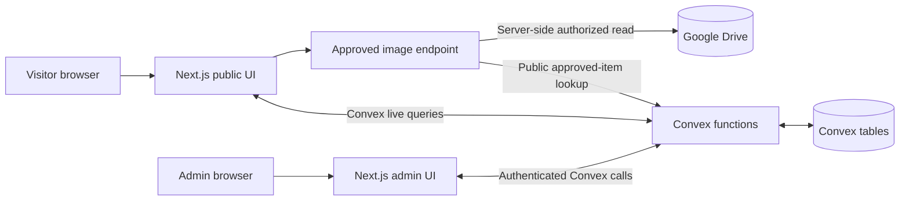
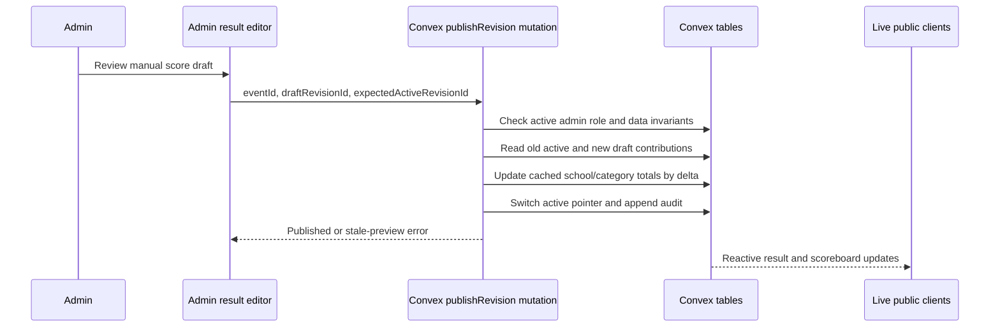

# Savvy Hunt — Technical Specification (Coding Agent)

**File:** `techspc.md`  
**Status:** Implementation contract (MVP); unconfirmed choices are labeled  
**Updated:** 28 October 2026  
**Read with:** [`prd.md`](./prd.md) · [`database.md`](./database.md) · [`appflow.md`](./appflow.md) · [`architectur.md`](./architectur.md) · [`plan.md`](./plan.md)

> **Mission:** Build a reliable, real-time school event website using **Next.js App Router + TypeScript + Convex + Vercel + Google Drive**. The hardest requirement is **manual points per event with automatic, exactly-once aggregation upon official publication**. Build that backend contract before polishing cards/animations.

## 1. Document ownership and precedence

| Document | Primary question |
|---|---|
| `prd.md` | **What** is the product and what counts as correct? |
| `database.md` | **What data** exists and how must scoring behave? |
| **`techspc.md`** | **How** is the application organized and implemented? |
| `appflow.md` | **How** do visitors and admins move through screens and states? |
| `architectur.md` | System boundaries, original architectural rationale. |
| `plan.md` | Full roadmap, requirements background and operations. |

If files appear to conflict: **owner-confirmed decisions override all defaults**. For a technical inconsistency, preserve scoring/security invariants, report the conflict and resolve it before making irreversible changes. No document grants permission to invent official event data.

## 2. Technology ownership

| Layer | Tool | Responsibility |
|---|---|---|
| Web UI | Next.js App Router + React + TypeScript | Routes, accessible components, rendering, forms and layout. |
| Real-time application/data | Convex | Queries, mutations, backend validation, audit history and scoring transactions. |
| Deployment | Vercel | Production Next.js hosting, env settings, server route handlers. |
| Media originals | Google Drive | Organizer-approved gallery files; never official result data. |
| Identity | **Supported Convex-compatible provider, not yet selected** | Sign-in/session only; backend allowlist owns actual admin access. |
| Styles/tests | Implementation choices pending | Can use lightweight styling and test tooling compatible with core stack. |

**Official categories:** Category I, Category II, Category III, Category IV, Category V, and Common Category. These are seeded as Convex records per edition.

**Do not migrate Supabase from reference repo.** Do not introduce Prisma, a second database, a polling service or public browser-side credential storage.

## 3. High-level architecture



**Rule:** Scoring logic lives in Convex. UI is allowed to display/preview values but cannot be the authority that updates total points. Google Drive holds only gallery assets. Convex subscriptions feed public live updates (no `setInterval` polling).

## 4. Project structure (recommended)

```text
savvy-hunt/
├── app/
│   ├── layout.tsx
│   ├── providers.tsx                   # client Convex + chosen auth provider
│   ├── (public)/
│   │   ├── layout.tsx                  # public header/footer
│   │   ├── page.tsx                    # /
│   │   ├── scoreboard/
│   │   │   ├── page.tsx
│   │   │   └── [categorySlug]/page.tsx
│   │   ├── schedule/page.tsx
│   │   ├── events/[eventSlug]/page.tsx
│   │   ├── results/page.tsx
│   │   ├── snapshots/page.tsx
│   │   └── about/page.tsx
│   ├── admin/
│   │   ├── layout.tsx                  # UX auth gate, not security boundary
│   │   ├── login/page.tsx
│   │   ├── page.tsx
│   │   ├── schools/page.tsx
│   │   ├── events/page.tsx
│   │   ├── events/[id]/results/page.tsx
│   │   ├── scoreboard/page.tsx
│   │   ├── gallery/page.tsx
│   │   ├── settings/page.tsx
│   │   └── audit/page.tsx
│   └── api/gallery/[itemId]/image/route.ts  # only when Drive proxy verified
├── components/
│   ├── ui/                            # reusable UI primitives
│   ├── layout/                        # Header, Sidebar, Footer
│   ├── events/                        # Card, StatusLabel, Filters
│   ├── schools/                       # SchoolEditor, SchoolList
│   ├── results/                       # DraftEditor, PublishPreview, Winners
│   ├── scoreboard/                    # OverallTable, CategoryTable, TopThree
│   └── gallery/                       # GalleryGrid, MediaEditor
├── convex/
│   ├── schema.ts
│   ├── editions.ts
│   ├── categories.ts
│   ├── schools.ts
│   ├── events.ts
│   ├── results.ts
│   ├── scoreboard.ts
│   ├── gallery.ts
│   ├── admins.ts
│   ├── siteSettings.ts
│   ├── audit.ts
│   └── lib/
│       ├── permissions.ts            # permission helper, every admin handler
│       ├── scoring.ts                # grouping, delta, rank helpers
│       └── validation.ts             # cross-edition validation
├── lib/
│   ├── constants.ts                  # category labels only; no school list
│   ├── format.ts                     # date/time/number display
│   └── drive.server.ts               # server-only Drive API utilities
├── scripts/seed.ts                    # idempotent, restricted seed strategy
├── tests/
│   ├── unit/scoring.test.ts
│   ├── integration/results.test.ts
│   └── e2e/results-flow.spec.ts
├── .env.example
├── prd.md
├── database.md
├── techspc.md
├── appflow.md
├── architectur.md
├── plan.md
└── README.md
```

**Convex generated files:** `convex/_generated/` comes from Convex CLI; do not hand-edit. File names can be adjusted if the chosen auth integration requires other files; document any deviations.

## 5. App Router and UI contracts

### Public routes

| URL | Main data reads | Main components |
|---|---|---|
| `/` | `scoreboard.getTopThree`, `events.listPublic`, `results.listRecentPublished`, `siteSettings.getPublic` | `TopThree`, `LiveEventStrip`, `RecentResults` |
| `/scoreboard` | `scoreboard.getOverall`, `categories.listCurrent` | `LeaderboardTable`, `CategoryTabs` |
| `/scoreboard/[categorySlug]` | `scoreboard.getCategory`, `categories.listCurrent` | `LeaderboardTable`, `CategoryTabs` |
| `/schedule` | `events.listPublic` | `EventFilters`, `EventCard` |
| `/events/[eventSlug]` | `events.getPublicBySlug`, `results.getPublishedByEvent` | `EventDetail`, `WinnerList` |
| `/results` | `results.listRecentPublished` | `ResultFeed` |
| `/snapshots` | `gallery.listApproved` | `GalleryGrid` |
| `/about` | `siteSettings.getPublic` | `AboutContent` |

### Admin routes

| URL | Actions |
|---|---|
| `/admin/login` | Start supported authentication flow. |
| `/admin` | Summarize work and link to school/event/result management. |
| `/admin/schools` | Create, edit, archive; server validates identity/permission. |
| `/admin/events` | Create/edit event; manually change status; filter by category. |
| `/admin/events/[id]/results` | Draft rows, preview delta, confirm publish, correction, revoke. |
| `/admin/scoreboard` | Inspect published totals and contribution history. |
| `/admin/gallery` | Curate, approve and hide Drive media. |
| `/admin/settings` | Public settings, edition configuration (super admin). |
| `/admin/audit` | Result and administration audit history (super admin). |

### Component rules

1. Keep `page.tsx` thin; extract feature UI and forms into `components/`.
2. `useQuery(api.*)` for live public data inside client components; `useMutation(api.*)` for writes. Use a single shared Convex React client/provider. SSR may preload data but **does not replace client subscriptions**.
3. Show `loading`, `empty`, `error`, `permission-denied`, and `offline/reconnecting` states distinctly.
4. Mutations must return actionable structured outcomes where appropriate: `{status: "created"}` / `{status: "published"}` / `{status: "already_published"}`; typed errors are handled as user-friendly messages.
5. Do not show a result as official based on local form state. Wait for mutation success and reactive public query updates.
6. Public UI must not expose admin-only notes, private student names or raw credential data.
7. Pages must work with keyboard, mobile viewport and screen reader-friendly labels.

## 6. Auth and permissions

**Implementation decision to make before `/admin/login`:** Choose a Convex-supported OIDC-compatible identity provider and verify the **current** Next.js App Router integration against its official docs. Identity provider configuration is not yet an organizer-confirmed choice; do not implement a homegrown insecure login.

**Authorization helper behavior** (illustrative pseudocode, not copy/paste API):

```ts
async function requireAdmin(ctx, requiredRole) {
  const identity = await ctx.auth.getUserIdentity();
  if (!identity) throw new Error("UNAUTHENTICATED");
  const stableAuthKey = identity.tokenIdentifier; // provider-scoped identity
  const admin = await findActiveAdminByAuthKey(ctx, stableAuthKey);
  if (!admin) throw new Error("FORBIDDEN");
  if (requiredRole === "super_admin" && admin.role !== "super_admin") {
    throw new Error("FORBIDDEN");
  }
  return admin;
}
```

- Run authorization **inside every Convex admin query/mutation/action**; hiding admin routes is not protection.
- Bootstrap first super admin with a **controlled private operation**, not open enrollment.
- Editor: manage school/event/drafts/gallery. Super admin: publish/revoke scores, manage admins/settings/audit (working default).
- Validate nested IDs and edition ownership on backend. Never trust supplied `role`, `editionId` or user email as proof of access.
- Any Drive route using admin capabilities must authenticate server-side and not accept arbitrary Drive file IDs.

## 7. Backend API implementation map

Follow the data shapes and detailed indexes in `database.md`.

| File | Public reads | Admin writes / reads |
|---|---|---|
| `convex/editions.ts` | `getCurrent` | current-edition control (super admin) |
| `convex/categories.ts` | `listCurrent` | idempotent seed/internal management |
| `convex/schools.ts` | `listActive` | `create`, `update`, `archive`, `listAdmin` |
| `convex/events.ts` | `listPublic`, `getPublicBySlug` | `create`, `update`, `setStatus`, `cancel`, `listAdmin` |
| `convex/results.ts` | `getPublishedByEvent`, `listRecentPublished` | `createDraft`, `upsertDraftEntry`, `deleteDraftEntry`, `previewRevision`, `publishRevision`, `revokePublished` |
| `convex/scoreboard.ts` | `getOverall`, `getCategory`, `getTopThree` | `getContributionBreakdown`, internal reconciliation |
| `convex/gallery.ts` | `listApproved`, `getApprovedItem` | `addDriveFile`, `updateMetadata`, `publish`, `hide`, `reorder` |
| `convex/admins.ts` | none | `getSelf`, `invite`, `updateRole`, `revoke` |
| `convex/siteSettings.ts` | `getPublic` | `update` |
| `convex/audit.ts` | none | `listAdmin` (role-guarded) |

**Keep `gallery.getApprovedItem` narrowly scoped:** return approved/consent-confirmed metadata needed for the image adapter; never expose credentials or a generic file fetch capability. Choose a server-appropriate way to query Convex without forwarding privileged service secrets to clients.

## 8. Score publication: no split transactions

**Do not implement a sequence of frontend mutation calls to do subtraction, addition, event update, audit write.** All of it belongs inside **one authorized Convex mutation**.



### Standard workflow

1. Admin selects event; event's category is fixed by event record.
2. Editor creates a **draft revision** and enters school + manual points; optional placement/label.
3. `previewRevision` computes before/after differences using current official revision; no write.
4. Super admin confirms publish with expected active revision ID.
5. Mutation validates each row; checks stale revision; calculates deltas; updates one logical total row per school/category; flips published pointer; audits and commits.
6. UI renders published result; public subscribed views update automatically.

### Status logic

- Event status (`upcoming`, `live`, `completed`, `postponed`, `cancelled`) is **independent** of whether an official result exists.
- Published results remain official during correction drafting.
- Completed + no official result → “Results pending.”
- Same revision already active → no-op; stale other revision → error/refresh, not silent override.
- Changing a category on scored events is blocked in normal edit flow.

## 9. Google Drive gallery implementation

### Phase 1: Curated-file workflow (working default)

1. Organizer uploads files to a school-controlled Google Drive folder using its normal Drive interface.
2. Admin enters/chooses an existing file through site admin UI (file ID/link parsed and validated).
3. Secure server-side integration checks **file exists**, is an approved image MIME type, permitted size, and accessible using the authorized credentials.
4. Convex stores the **file ID and metadata**, never the media bytes; admin sets alt text/caption, verifies photo permission, and approves.
5. Public only sees approved media; image delivery uses **item ID** to look up an approved record, not a caller-supplied Drive file ID.

### Image delivery safety

```text
GET /api/gallery/[itemId]/image
  -> validate itemId
  -> fetch approved, consent-confirmed gallery metadata
  -> resolve fixed Drive file ID server-side
  -> read only that approved image using server-held credentials
  -> verify MIME/size, set cache/privacy policy, stream/return response
  -> handle missing/inaccessible file with safe placeholder/status
```

- Direct Drive public links may be provided **only if organizers intentionally approve public sharing**. Drive preview/thumbnail URLs are not a guaranteed high-traffic CDN.
- Verify Google Drive API authorization and server deployment economics first. If a secure image endpoint cannot be implemented for MVP, show curated approved links/placeholder until approved alternative delivery is chosen; **do not fabricate working images**.
- Prevent arbitrary Drive file proxying, credential exposure, cache leakage after hide, and public folder enumerations.
- Direct website upload to Drive is **Phase 2**, not assumed to be approved.

## 10. Environment configuration

```dotenv
# Browser-readable public deployment URL
NEXT_PUBLIC_CONVEX_URL=

# Authentication variables: provider-specific, decide after choosing provider
# ...

# Server-only Google Drive integration (exact auth model TBD)
GOOGLE_DRIVE_FOLDER_ID=
GOOGLE_CLIENT_ID=
GOOGLE_CLIENT_SECRET=
GOOGLE_REFRESH_TOKEN=
```

**These are illustrative variable names, not an approved final auth strategy.** Use service-account configuration only if the school's Drive-sharing and provider setup support it. Keep secrets in Vercel/Convex environment settings appropriate to their execution location. Never commit credentials or use `NEXT_PUBLIC_` for any secret.

### Environments

| Environment | Frontend | Backend | Data/media |
|---|---|---|---|
| Local | Next.js dev | Convex development deployment | Dummy schools/results; test media only. |
| Preview | Vercel Preview | Explicitly configured nonproduction Convex | Never publish real results by mistake. |
| Production | Vercel Production | Dedicated Convex production | Official edition and approved Drive folder. |

## 11. Error handling and operational rules

| Scenario | API behavior | UI behavior |
|---|---|---|
| Not signed in | `UNAUTHENTICATED` | Redirect/login; do not show protected data. |
| Signed in but not allowlisted | `FORBIDDEN` | Explain lack of access; no repeated mutation retries. |
| Invalid school/category/event IDs | `VALIDATION_ERROR` | Keep form values; show specific field error. |
| Stale publish preview | `STALE_REVISION` | Refresh official result and preview before resubmitting. |
| Duplicate school/code/slug | `CONFLICT` | Highlight existing name/code; preserve input. |
| Drive file inaccessible | `MEDIA_UNAVAILABLE` | Show placeholder and admin fix instructions. |
| Convex network disconnected | Client reconnect mechanism | Show reconnecting status; never promise publication succeeded. |
| Mutation outcome uncertain | Inspect actual official revision | Recheck backend state before any retry. |

**Never** optimistically update the official public scoreboard on an unconfirmed publish request. Use optimistic drafts for form usability only, and confirm backend success for official state.

## 12. Testing contract

### Unit tests (pure `scoring.ts`)

- [ ] Group multiple rows for the same school accurately.
- [ ] Calculate category/overall totals across six categories.
- [ ] Common Category counted exactly once.
- [ ] Compute old-vs-new deltas for additions, removals and replacements.
- [ ] Ties use competition rank `1, 1, 3`; presentation ordering does not create fake rank.
- [ ] Reject malformed/fractional/negative (current default) point values.

### Convex integration tests

- [ ] Draft changes are not visible publicly.
- [ ] Authorized publication updates totals and active revision atomically.
- [ ] Idempotent re-publish; correction; revoke; stale revision race.
- [ ] Cross-edition references, inactive admins and unauthorized roles blocked.
- [ ] Public queries redact internal notes/private names/hidden photos.

### End-to-end UI tests

- [ ] Create school → create event → enter draft → preview → publish → public score updates in second browser session.
- [ ] Category and overall views both reflect official result; Common counted once.
- [ ] Completed event with no result displays “Results pending.”
- [ ] Responsive schedule/scoreboard/admin forms and loading/empty/error states.
- [ ] Gallery item hidden after approval disappears from public list; server image delivery respects takedown policy.

Use compatible test tooling (e.g. Vitest for units and Playwright for E2E) **only if the team approves or these are already available**. Tests must be runnable locally and in CI.

## 13. Build order and agent checkpoints

| Step | Implement | Exit condition |
|---|---|---|
| 0 | Project setup, environment docs, TypeScript checks | App runs and connects to Convex dev. |
| 1 | Schema + edition/six category seed | Categories appear once; no duplicates on rerun. |
| 2 | Auth + active admin allowlist | Public users cannot write admin data. |
| 3 | School CRUD, event CRUD/status | Admin can add a school/event; public schedule shows it. |
| 4 | Draft results and manual score editor | Saved draft visible only to authorized users. |
| 5 | Atomic publish, correction, revoke, audit | Backend tests pass, totals always reconcile. |
| 6 | Reactive scoreboards, top three, results | Two spectator clients update without reload. |
| 7 | Gallery, content/settings, responsive polish | Approved images only; fallback works. |
| 8 | E2E, security, load, deployment rehearsal | MVP acceptance matrix passes. |

**At each checkpoint:** report changed files, commands/tests executed, passing/failing results, blockers and decisions needed. Never claim tests passed if not run.

## 14. Completion criteria

- [ ] All P0 routes from `prd.md` implemented using **real Convex data**.
- [ ] Every admin function enforces backend identity and role checks.
- [ ] Published results are backed by exactly one active revision per event.
- [ ] School/category/overall totals computed from active published results only.
- [ ] Real-time queries update live clients without polling.
- [ ] Correction and revoke do not double count.
- [ ] Gallery cannot expose hidden/unapproved images via list **or image endpoint**.
- [ ] Development/prod configuration separated and documented.
- [ ] Tests and launch-day manual tally fallback documented.

## 15. Official implementation references

- Convex Next.js App Router: https://docs.convex.dev/client/nextjs/app-router/
- Convex authentication overview: https://docs.convex.dev/auth/overview
- Convex authentication inside functions: https://docs.convex.dev/auth/functions-auth
- Convex schema/indexes: https://docs.convex.dev/database/overview
- Google Drive file retrieval: https://developers.google.com/workspace/drive/api/guides/manage-downloads
- Vercel environment configuration: https://vercel.com/docs/environment-variables

**Coding instruction:** Follow product rules in `prd.md`, data constraints in `database.md`, and screen transitions in `appflow.md`. Prioritize the secured P0 vertical slice over superficial page completion. Stop and flag contradictions involving confirmed requirements, privacy, cost, authentication or official scoring policy.
